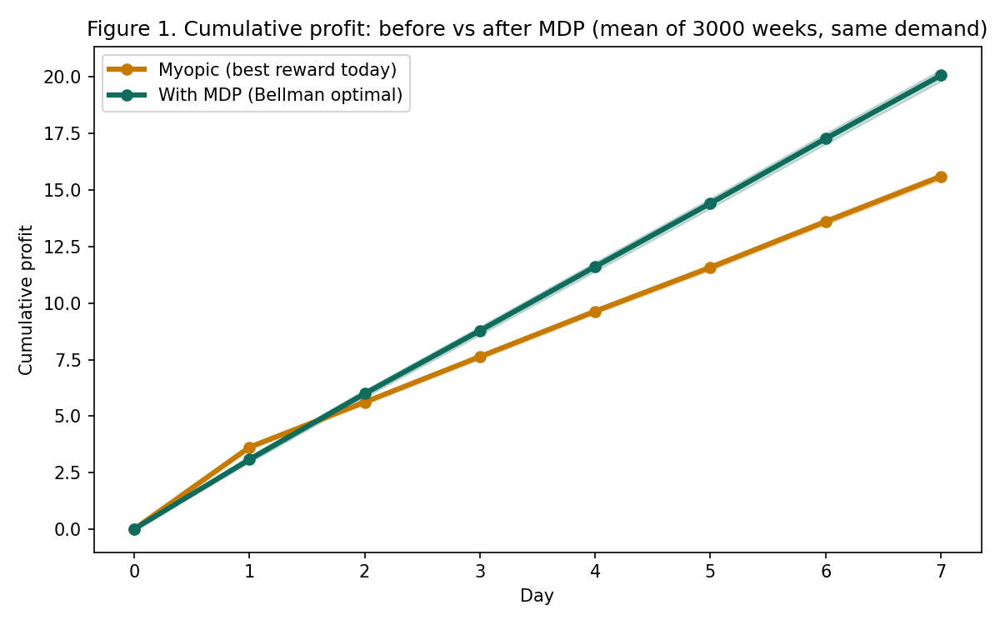
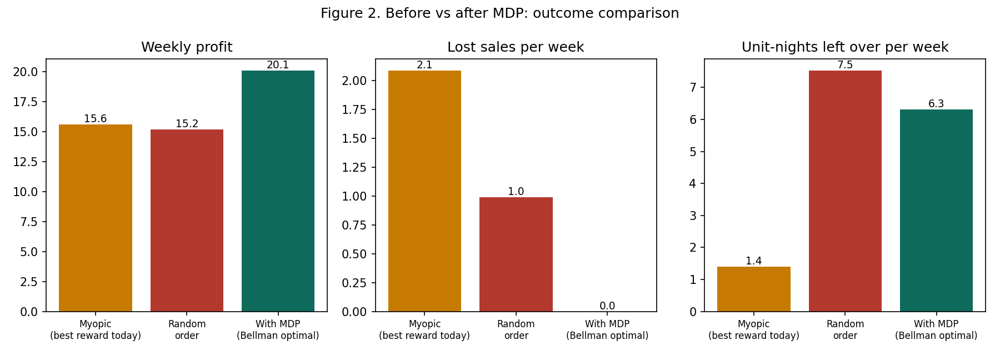
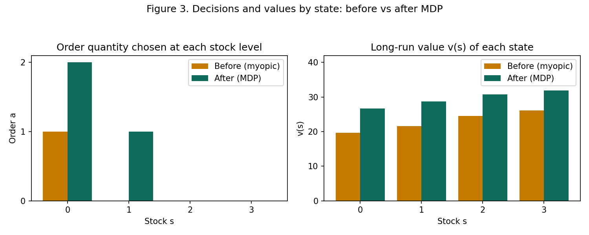
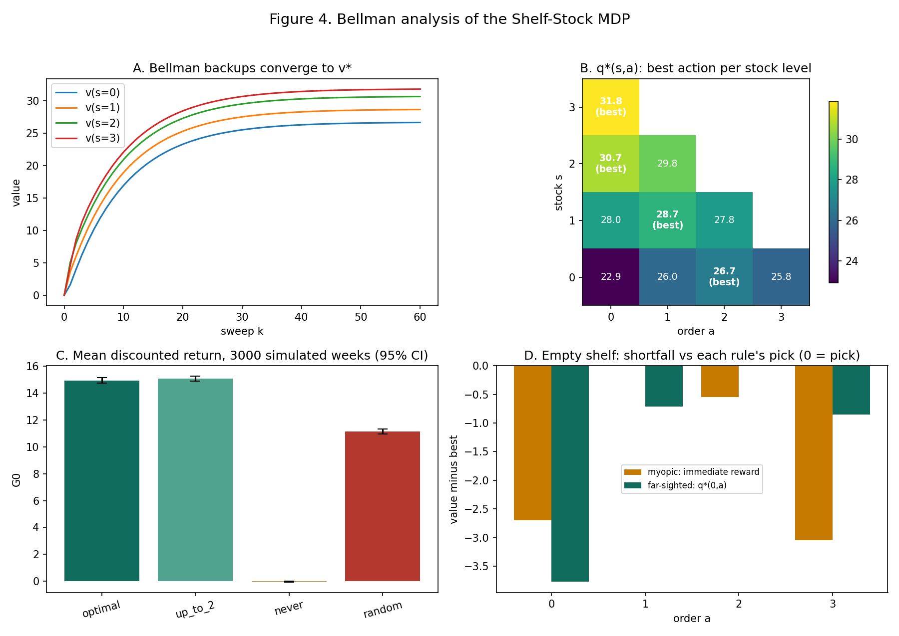

# Shelf-Stock MDP

**Modelling daily restocking as a Finite Markov Decision Process, and comparing decisions before and after solving it**

A small shop decides each morning how many units of one perishable item to order. Today's order changes tomorrow's stock, and customer demand is random. This project models that as a finite MDP, solves it with the Bellman optimality equation, and compares decisions **before** (no MDP) and **after** (with MDP).

**Scope:** MDP design and planning only. The dynamics are known, so the solution is dynamic programming (value iteration). No learning agent is implemented; Q-learning is proposed as future work.

## Contents

```
shelf_stock_mdp/
├── README.md
├── requirements.txt
├── inventory_mdp.py        MDP definition, value iteration, policy evaluation, simulation
├── make_figures.py         generates Figures 1-3
├── viz_mdp.py              generates Figure 4
├── mdp_prototype.html      interactive prototype (open in a browser)
└── images/
    ├── figure1_cumulative_profit.png
    ├── figure2_outcome_comparison.png
    ├── figure3_decisions_and_values.png
    └── figure4_bellman_analysis.png
```

| Figure | File | Script | Shows | Type |
|---|---|---|---|---|
| 1 | `figure1_cumulative_profit.png` | `make_figures.py` | Profit build-up over a week, before vs after MDP | Simulated |
| 2 | `figure2_outcome_comparison.png` | `make_figures.py` | Profit, lost sales and leftover stock, before vs after MDP | Simulated |
| 3 | `figure3_decisions_and_values.png` | `make_figures.py` | Order chosen and long-run value at each stock level | Exact |
| 4 | `figure4_bellman_analysis.png` | `viz_mdp.py` | Bellman convergence, q\* table, policy returns, look-ahead | Exact and simulated |

## Run

```bash
pip install -r requirements.txt
python inventory_mdp.py     # solves the MDP, prints Bellman analysis and simulation
python make_figures.py      # writes Figures 1-3 into images/
python viz_mdp.py           # writes Figure 4 into images/
```

Open `mdp_prototype.html` in a browser for the interactive version. No install needed. Run the commands from inside this folder.

## MDP design

| Element | Definition |
|---|---|
| Agent | Restocking controller |
| Environment | Shelf, supplier, customers |
| State | Stock at start of day, s ∈ {0, 1, 2, 3} |
| Action | Order a ∈ {0, …, 3 − s} (10 state-action pairs) |
| Dynamics | Demand d ∈ {0, 1, 2} with P = 0.2, 0.5, 0.3. Sold = min(d, s + a). Next state s′ = s + a − sold |
| Reward | +5 per unit sold, −2 per unit ordered, −0.5 per unit left overnight, −1 per unit of unmet demand |
| Goal | Maximise expected long-run profit |
| Episode | One 7-day week, starting at s = 1 |
| Return | G = Σ γᵗ Rₜ₊₁, γ = 0.9 |
| Policy | π(s): order quantity for each stock level |
| Value function | v_π(s) = E[G given s, following π] |

Bellman optimality equation used:

```
v*(s) = max_a  Σ_d P(d) [ r(s,a,d) + γ v*(s′) ]
```

Prices, costs and demand probabilities are illustrative assumptions, not measured data.

## Before vs after the MDP

"Before" is a manager with no value function, who decides without modelling future consequences:

- **Myopic:** picks the order with the best expected reward today. Here that means ordering 1 unit only when the shelf is empty.
- **Random:** any allowed order quantity.

"After" is the policy from solving the MDP. In Figures 1 and 2, all managers see the **same** demand in every simulated week (3,000 weeks, fixed seed).

| | Myopic | Random | With MDP |
|---|---|---|---|
| Order at stock 0, 1, 2, 3 | 1, 0, 0, 0 | random | 2, 1, 0, 0 |
| Mean weekly profit | 15.6 | 15.2 | **20.1** |
| Lost sales per week | 2.09 | 0.99 | **0.00** |
| Unit-nights left over per week | 1.40 | 7.52 | 6.32 |

## Figures

### Figure 1. Cumulative profit through the week, before vs after MDP



*How to read it:* x-axis is the day of the week, y-axis is cumulative profit averaged over 3,000 simulated weeks. Shaded bands are 95% confidence intervals (very narrow). The orange line is the myopic manager, the green line is the MDP manager.

*What it shows:* the myopic manager is slightly ahead on day 1 (about 3.6 against 3.1) because it avoids ordering costs. By about day 2 the MDP manager catches up, and it then pulls away, finishing the week at about 20.1 against 15.6. The myopic manager keeps hitting an empty shelf and losing sales. The MDP manager accepts a small early cost to stay stocked. This is the value of looking ahead.

### Figure 2. Outcome comparison: profit, lost sales and leftover stock



*How to read it:* three bar charts for the same 3,000 weeks, each comparing myopic, random and MDP. Left: mean weekly profit (higher is better). Middle: units of demand lost per week (lower is better). Right: unit-nights of stock left on the shelf per week (lower is better).

*What it shows:* the MDP policy earns the most profit and loses no sales. It does hold more unsold stock than the myopic rule (6.3 against 1.4 unit-nights per week). That is a trade-off, not a free win: the reward function charges 0.5 per leftover unit but 1 per lost sale and forgoes 5 of revenue, so carrying a little extra stock pays off.

### Figure 3. Decisions and values by state



*How to read it:* left, the order quantity each policy chooses at stock 0, 1, 2 and 3. Right, the long-run value v(s) of starting a day in each state under each policy. Values come from exact policy evaluation, not simulation.

*What it shows:* the MDP policy orders 2 units at stock 0 and 1 unit at stock 1, while the myopic policy orders only 1 unit at stock 0. Every state has a higher value under the MDP policy: v\* is 26.7, 28.7, 30.7 and 31.8 for stock 0 to 3, against 19.6, 21.6, 24.5 and 26.1 for the myopic policy. The gap shows what ignoring the future costs.

### Figure 4. Bellman analysis of the Shelf-Stock MDP



*Panel A, Bellman backups converge to v\*:* each curve is v(s) for one state, starting at 0 and updated by repeated Bellman optimality backups. All four settle after roughly 40 sweeps. This shows value iteration working.

*Panel B, q\*(s,a) table:* each cell is the long-run value of ordering a units at stock s. The best action in each row is marked. Reading the best cell per row gives the optimal policy: order 2, 1, 0, 0. For example at stock 0, order 2 (26.7) beats order 0 (22.9), 1 (26.0) and 3 (25.8).

*Panel C, mean discounted return per policy:* simulated over 3,000 weeks with 95% confidence intervals. Optimal is about 14.9 and order-up-to-2 about 15.1 (statistically tied, because they make the same decisions), random about 11.2, never order about 0.

*Panel D, look-ahead at an empty shelf:* for each order quantity, how far it falls short of the best choice under two rules. The myopic rule (orange) picks order 1 because it scores best on reward today. The far-sighted rule (green, using q\*) picks order 2. Same state, different decision, because only q\* counts future value.

## Limits

- A simple hand-tuned rule, "order up to 2 units", makes exactly the same decisions as the MDP policy for these numbers (Panel C of Figure 4 shows them tied). The MDP's advantage is that it finds such a rule from the problem definition, not that it earns more than a well-chosen rule.
- Zero lost sales in Figure 2 follows from the model: demand never exceeds 2, and the MDP policy keeps at least 2 units available each day.
- The model is deliberately small (4 states) so the Bellman equations can be solved exactly. Real shops would need more state (supplier delay, perishability, day of week).
- Figures 1 and 2 are Monte Carlo estimates and vary slightly with the seed. Figure 3, Panel A and Panel B of Figure 4, and all v\* values are exact. Panel C is simulated.

